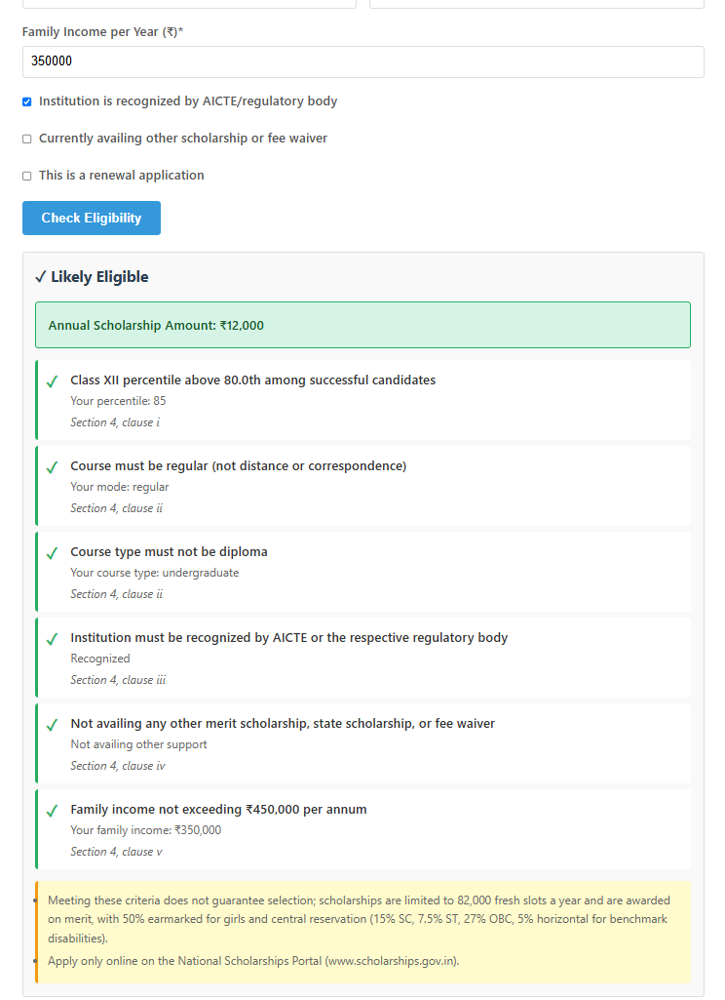
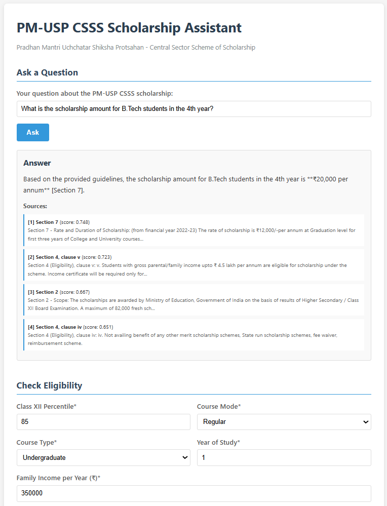

# Scheme Assistant (LLM Knowledge Assistant)





A retrieval-augmented question-answering assistant for the **PM-USP CSSS scholarship** (Ministry of Education, applicable 2022-23 onwards). It answers questions using only the official guidelines PDF, cites the section it used, and refuses when the document does not contain the answer. It also includes a rule-based eligibility checker, a Flask API with a web page, and an evaluation suite.

## How it works

1. **Ingest** (`src/ingest.py`): the guidelines PDF is split by its 11 numbered sections plus a short preamble. Sections 4 (eligibility) and 6 (application procedure) are split into one chunk per clause. This gives 26 chunks, each with a short context header (section and clause). Chunks longer than 1200 characters are split further with LangChain's `RecursiveCharacterTextSplitter`.
2. **Embed and index**: chunks are embedded locally with `BAAI/bge-small-en-v1.5` (normalized vectors) and stored in a FAISS `IndexFlatIP` index.
3. **Retrieve** (`src/rag.py`): the question is embedded with the bge query prefix and the top 4 chunks are returned. If the best score is below `MIN_SCORE` (0.35), the app refuses without calling the LLM.
4. **Generate**: the full text of the 4 chunks and the question are sent to an LLM with a strict prompt: answer only from the context, cite `[Section N]`, otherwise say "I don't know...".
5. **Grounded flag**: `grounded` is `False` when the score gate fires or when the model's answer is a refusal.
6. **Eligibility** (`src/eligibility.py`): plain rules with thresholds read from `data/schemes.json`, each result citing the guideline clause it comes from. No LLM is involved, so decisions are deterministic. Fresh applications are checked against Section 4 clauses i to v. Renewals are checked against the ongoing conditions (clauses ii, iii and iv) plus the renewal criteria in clause viii (50% marks, 75% attendance, no disciplinary or criminal complaint). Class XII percentile and family income are not re-checked at renewal, because the guidelines require the income certificate only for fresh applicants. This is the checker's interpretation of the guidelines, not an official ruling.

```
PDF guidelines
   -> section-aware chunking (26 chunks)
   -> bge-small embeddings -> FAISS index

Question
   -> retrieve top 4 chunks
   -> score gate (refuse below 0.35)
   -> LLM with strict prompt
   -> answer + [Section N] citations
```

## Stack

Python, FAISS, sentence-transformers, LangChain text splitters (only for oversized chunks), Flask, python-dotenv, pytest. The LLM is called through the `openai` Python client against any OpenAI-compatible endpoint. The evaluation ran on Gemini models through a local router (OmniRoute). The code can point at other compatible endpoints by changing `.env`.

## Evaluation

A 20-question golden set (16 answerable, 4 out-of-scope) in `eval/golden_set.json`. Run it with `python -m eval.run_eval --judge`.

| Metric | Result |
|---|---|
| Hit@4 (right section retrieved) | 100% (16/16) |
| MRR | 0.938 |
| RAG answer correctness | 16/16 |
| Refusal accuracy (out-of-scope) | 4/4 |
| Same model, no retrieval: correctness | 9/16 |
| Same model, no retrieval: out-of-scope questions | specific unsourced answers on 2 of 4 (labels checked by hand) |
| Faithfulness (LLM judge) | 16/16 |

Run details: model `gemini-pro-agent` via a local router, 0 errors, 0 judge errors.

### How to read these numbers

- The golden set is small (20 questions) and was written and adjusted during development, so these are scores on my own test set, not general accuracy.
- During development I corrected four test-set items against the PDF text (expected sections for Q4, Q5 and Q6; the wording of Q11). Part of the rise in Hit@4 and MRR comes from those corrections, not from changes to retrieval.
- Correctness is a string-match check on expected values, which is lenient. The no-retrieval score of 9/16 may be helped by short numeric matches.
- The faithfulness judge is the same model family as the answerer, so it is a self-graded signal.
- On the out-of-scope questions, the refusals came from the model following the prompt. The 0.35 score gate did not trigger on any of the 20 test questions, and the threshold was set by hand, not tuned.
- The judge's label for one no-retrieval answer changed between runs, so I checked those labels by reading the answers.

### Bug found through evaluation

An early failure on "B.Tech 4th year" came from truncating each chunk to 500 characters before sending it to the LLM, which cut off the relevant sentence. Sending the full chunk fixed it.

## Setup

```
python -m venv .venv
.venv\Scripts\activate
pip install -r requirements.txt
copy .env.example .env
python -m src.ingest
python -m src.app
```

Open http://127.0.0.1:5000. In `.env`, set `LLM_BASE_URL`, `LLM_API_KEY` and `LLM_MODEL` for any OpenAI-compatible endpoint. Other settings: `EVAL_LLM_MODEL`, `EMBED_MODEL`, `TOP_K` (default 4) and `MIN_SCORE` (default 0.35).

Tests: `python -m pytest` (30 eligibility tests).

## API

- `GET /health`
- `POST /ask` with `{"question": "..."}` returns `answer`, `sources`, `grounded`, `top_score` and `model_used`.
- `POST /eligibility` with the applicant fields returns `eligible`, a list of per-rule `checks`, `annual_amount` and `notes`.

## Project layout

```
src/
  config.py        settings from .env
  ingest.py        PDF -> chunks -> embeddings -> FAISS index
  rag.py           retrieval, prompt, refusal handling, no-RAG baseline
  eligibility.py   rule-based eligibility checker
  app.py           Flask API and web page
  templates/index.html
data/
  raw/pm-usp-csss-guidelines.pdf
  schemes.json
eval/
  golden_set.json
  run_eval.py
tests/
  test_eligibility.py
```

## Limitations

- Covers one document (the PM-USP CSSS guidelines).
- No conversation memory; each question is answered independently.
- `MIN_SCORE` is hand-set and was never triggered by the test questions.
- Small evaluation set, partly tuned during development.
- The eligibility checker follows my reading of the guidelines. They do not say whether the income limit applies again at renewal, so the checker does not enforce it then. It also does not decide selection, which depends on merit, quotas and reservation.
- Thinking models add latency, and free quotas limit how much can be run.
- Guidelines are as of the PDF's publication; check the official portal for current rules.